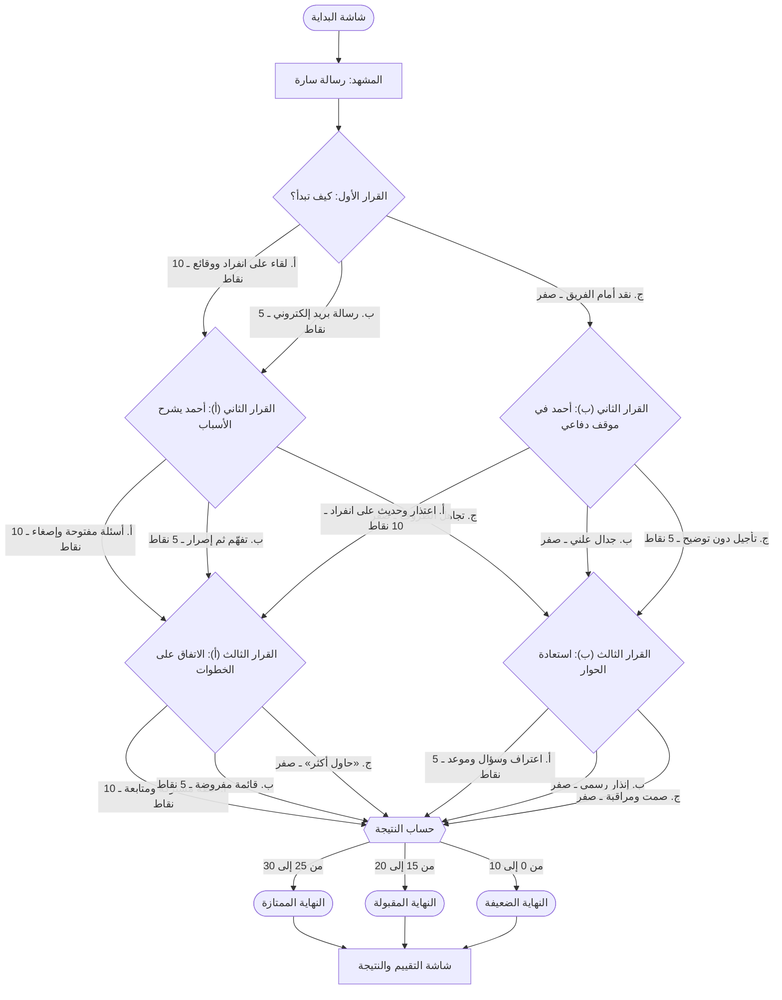
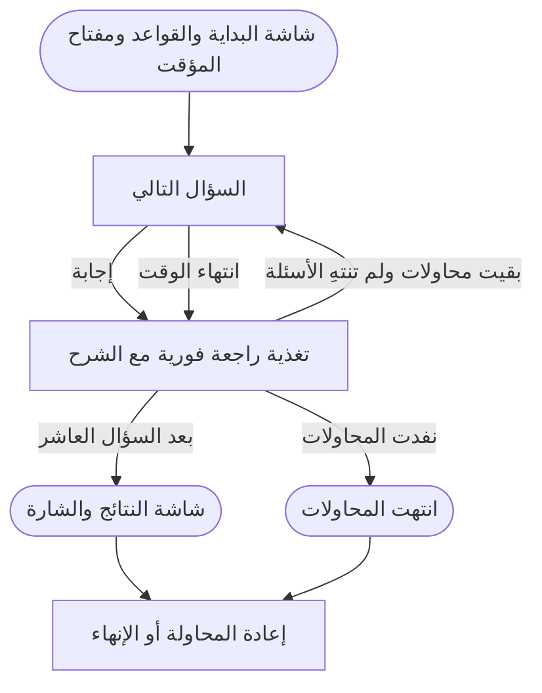

# Arabic Interactive E-Learning Samples: Build Spec

| Item | Value |
|---|---|
| Deal | CRM-DEAL-2026-00469: Upwork job "Freelance AI-Powered Interactive E-Learning Developer (Arabic Content)" |
| Job link | https://www.upwork.com/jobs/~022116276116686508470 |
| Owner | Muhammad Aboulmagd (Senlite / Twin Particles) |
| Builder | Mahmoud Mesbah (Twin Particles), working through a Cursor agent |
| Time box | 2 working days |
| Version | 1.0, 2026-11-04 |
| Status | Ready to build. Open questions are listed in §19, with safe defaults so work can start now. |

**How to use this document.** Each section has a number (§1, §2 and so on). The prompts in §16 point the Cursor agent to these numbers. Put this Markdown file in the repo as `docs/SPEC.md` so the agent can read it. All learner-facing Arabic text is final copy, so paste it exactly as written. Change it only if §19 says so.

---

## 1. Purpose and success criteria

**Purpose.** Build two short Arabic (RTL), mobile-friendly, browser-based interactive activities. They will be Muhammad's portfolio for the Upwork application. The client asks for "links to interactive e-learning activities they have personally developed" and for Arabic examples, and today we have none (see `analysis.md`). The samples must show the formats the client named: a branching scenario for leadership and soft skills, and a gamified assessment for compliance and safety. Both must be built with an AI-assisted workflow and plug into an LMS through SCORM.

**Success criteria.** A sample is done when all of these are true:

1. **It works as a public link.** Anyone can open it on a phone or desktop with no login, from a GitHub Pages (or Netlify) URL, and finish it in 5–8 minutes.
2. **It is fully Arabic RTL.** The layout is right-to-left, the Arabic font is clean, there is no broken mixed Arabic/English text, and the copy is professional Modern Standard Arabic suited to a Gulf workplace.
3. **It works on mobile.** It runs on a 360 px wide phone with touch, including drag and drop, with no horizontal scrolling and touch targets of at least 44 × 44 px.
4. **It runs in an LMS.** The SCORM 1.2 zip imports into SCORM Cloud and/or the Moodle sandbox, launches, and reports completion and score.
5. **It shows real design, not just a quiz.** Choices have consequences, feedback explains why, and there is a debrief or results screen with a score. The game elements (points, lives, timer, progress, badge) work.
6. **It is ready to show.** There is a 1-minute recording or GIF of each sample, plus a README in English and Arabic.

---

## 2. Context (from the job post, not invented)

- The client is in Saudi Arabia. Payment is verified, they have 4.72★ from 88 reviews, and the role is hourly at $20–$60/hr, part-time, expert level.
- The work is to turn existing slides, PDFs and Word files into browser-based Arabic RTL activities that work on mobile: branching scenarios, decision exercises, simulations, gamified challenges and puzzles, and interactive assessments. Topics are leadership, management, soft skills, compliance, safety and professional development.
- Preferred: AI tools (ChatGPT, Claude, Cursor), Storyline, H5P or Genially, LMS integration, SCORM/xAPI.
- The applicant must send portfolio links, a short description of the AI tools they use, and Arabic interactive examples.
- The key line in the post: "not just traditional e-learning slides or quizzes".

**Design implication.** We build custom HTML5/JS rather than authoring-tool output. This shows the "AI-assisted custom build" strength. We keep the content in a separate data file (`content.js`) so the same engine can be reused for the client's real decks later. That reuse is the pitch: "your deck → new content file → new activity in hours".

---

## 3. Learning objectives (Bloom's verbs)

### 3.1 Sample 1: "Giving feedback to an employee" (leadership / soft skills)

After the activity, the learner (a team leader or manager) will be able to:

| # | Objective | Bloom level |
|---|---|---|
| L1 | **Apply** the Situation–Behaviour–Impact (SBI) model to open a feedback conversation with specific, observable facts. | Apply |
| L2 | **Distinguish** behaviour-based feedback from personal judgements and public criticism. | Analyse |
| L3 | **Select** open questions and listening responses that uncover the root cause of a performance drop. | Apply |
| L4 | **Evaluate** how each leadership choice affects performance, trust and retention. | Evaluate |
| L5 | **Formulate** a specific follow-up plan agreed with the employee, with a review date. | Create |

On-screen version (Arabic), shown on the intro screen:

> بنهاية هذا النشاط ستتمكّن من:
> - تطبيق نموذج «الموقف – السلوك – الأثر» لبدء محادثة التغذية الراجعة بوقائع محددة.
> - التمييز بين التغذية الراجعة المبنية على السلوك والأحكام الشخصية.
> - اختيار أسئلة مفتوحة تكشف السبب الحقيقي لتراجع الأداء.
> - تقييم أثر قراراتك القيادية في الأداء والثقة.
> - صياغة خطة متابعة محددة بالاتفاق مع الموظف.

### 3.2 Sample 2: "Workplace safety challenge" (compliance / safety)

After the activity, the learner (any employee) will be able to:

| # | Objective | Bloom level |
|---|---|---|
| S1 | **Identify** common workplace hazards (slip, trip, blocked exit) in a realistic scene. | Remember / Apply |
| S2 | **Select** the right fire extinguisher for an electrical fire. | Apply |
| S3 | **Sequence** the RACE fire-response steps and the lockout/tagout steps. | Apply |
| S4 | **Recognise** signs of heat stress and **choose** the right first response. | Understand / Apply |
| S5 | **Interpret** the meaning of ISO 7010 safety-sign shapes and colours. | Understand |
| S6 | **Explain** why near misses and fire-door rules matter. | Understand |

On-screen version (Arabic):

> بنهاية هذا التحدي ستتمكّن من:
> - التعرّف على المخاطر الشائعة في بيئة العمل.
> - اختيار طفاية الحريق المناسبة لكل نوع من الحرائق.
> - ترتيب خطوات الاستجابة للحريق وخطوات عزل الطاقة قبل الصيانة.
> - التعرّف على علامات الإجهاد الحراري والتصرّف الصحيح.
> - تفسير ألوان لافتات السلامة وأشكالها.

---

## 4. Sample 1: Branching scenario, "محادثة التغذية الراجعة"

### 4.1 Overview

- **Folder:** `feedback-scenario/`
- **Arabic title:** محادثة التغذية الراجعة: موقف قيادي
- **Format:** a branching scenario with 3 decision points and 3 choices each. Every choice shows feedback and a consequence. The scenario has 3 endings (best, OK, poor) and a debrief screen with a score.
- **Duration:** 5–7 minutes.
- **Characters:** the learner (team leader, addressed as «أنت»), **أحمد** (a senior analyst on the learner's team), and **سارة** (the department director).
- **Setting:** a reporting team in a fictional company. No real company or client names.
- **Language note:** Choices are written in the first person (أطلب، أقول), so they read the same for men and women. Where Arabic has to use a gender, it uses the standard generic second-person masculine common in Gulf corporate training. A gender toggle is optional (see §19).

### 4.2 Scoring and branching rules

- Each choice is worth **10** (best practice), **5** (partly right) or **0** (poor). The maximum is **30**.
- The ending is decided by the total score:
  - **Best:** 25–30
  - **OK:** 15–20
  - **Poor:** 0–10
  (All scores are multiples of 5, so these bands leave no gaps.)
- Branching: D1 → D2A or D2B → D3A or D3B → ending (by score). The table in §4.5 gives the `next` field for every choice.
- Show the choices in **random order** on every attempt, so the best answer isn't always first. Decisions are final: there is no back button inside the scenario.
- **SCORM:** `cmi.core.score.raw` = round(total / 30 × 100), with min 0 and max 100. `cmi.core.lesson_status` = `completed` when the debrief screen is reached. There is no pass/fail.

### 4.3 Branching map (Mermaid)



In the map, أ/ب/ج are the choice letters. In `content.js` they are the IDs -A/-B/-C (for example D2B-A); on screen the choices are shuffled. Paths that can be reached, with their score and ending: D1A→D2A-A→D3A-A = 30 (best). D1C→D2B-A→D3A-A = 20 (OK, because the learner recovered). D1A→D2A-C→D3B-A = 15 (OK). D1C→D2B-B→D3B-B = 0 (poor).

### 4.4 Screen-by-screen flow

| # | Screen | Content | Interaction |
|---|---|---|---|
| 1.1 | Start | Title, one-line description, duration, illustration, «ابدأ» button | Tap «ابدأ» |
| 1.2 | Objectives | The Arabic objectives from §3.1 | «التالي» |
| 1.3 | Context | Sara's message (shown as a chat or email card) and background on Ahmed | «التالي» |
| 1.4 | Decision 1 | Scene text, question, 3 choice cards, header «القرار 1 من 3» and progress dots | Choose a card. It is selected straight away (no confirm step). |
| 1.5 | Feedback 1 | Rating badge (موفّق / مقبول جزئياً / غير موفّق) with icon and colour, feedback text, consequence text, points earned | «تابِع» |
| 1.6–1.9 | Decisions 2 and 3, each with its feedback | Same layout, on the D2A/D2B and D3A/D3B branch | Same |
| 1.10 | Ending | Ending title, illustration, ending narrative | «عرض التقييم» |
| 1.11 | Debrief | Score (e.g. «25 من 30 – 83%»), ending label, the learner's path (decision, choice, points), 4 key tips (SBI), «أعد المحاولة», «إنهاء النشاط» | «إنهاء النشاط» sends SCORM data. «أعد المحاولة» resets the state. |

UI rules:
- Show a header on every screen with the title, «القرار X من 3», and a progress bar or dots. The progress bar fills from right to left.
- The rating colours are green, amber and red, **always paired with an icon and a text label**, so meaning never depends on colour alone.
- On a phone, choice cards stack in one column. On a wide screen they can sit in a grid. Each card is a real `<button>`.

### 4.5 Full Arabic script

Each block below is one entry in `content.js`. Keep the IDs, `points` and `next` values exactly as written.

#### Screen 1.1: Start

- **العنوان:** محادثة التغذية الراجعة: موقف قيادي
- **الوصف:** أنت قائد فريق، وستخوض محادثة تغذية راجعة مع أحد أعضاء فريقك. كل قرار تتخذه يغيّر مسار المحادثة ونتيجتها.
- **المدة:** المدة التقريبية: 5–7 دقائق
- **الزر:** ابدأ

#### Screen 1.2: Objectives
Use the on-screen text from §3.1. Heading: **ماذا ستتعلّم؟**. Button: **التالي**.

#### Screen 1.3: Context (المشهد)

- **العنوان:** صباح يوم الأحد
- **رسالة من سارة (مديرة الإدارة):** «صباح الخير. تأخّر التقرير الأسبوعي الذي يعدّه أحمد ثلاث مرات هذا الشهر، ووصلت النسخة الأخيرة إلى العميل وفيها أخطاء في الأرقام. أحمد من أفضل المحللين لدينا، وأريدك أن تتحدث معه هذا الأسبوع.»
- **خلفية:** يعمل أحمد في فريقك منذ أربع سنوات، وكان أداؤه ممتازاً حتى الشهرين الماضيين.
- **الزر:** التالي

#### D1: القرار 1 من 3: كيف تبدأ؟

**Scene:** ترى أحمد في المكتب المفتوح، وحوله عدد من الزملاء. ما خطوتك الأولى؟

| ID | Choice (Arabic) | Pts | Rating | Feedback (Arabic) | Consequence (Arabic) | next |
|---|---|---|---|---|---|---|
| D1-A | أطلب من أحمد لقاءً قصيراً على انفراد اليوم، وأبدأ بذكر الوقائع: تأخّر التقرير ثلاث مرات هذا الشهر، ووجود أخطاء في النسخة الأخيرة. | 10 | موفّق | اختيار موفّق. التغذية الراجعة على انفراد تحفظ كرامة الموظف، والبدء بوقائع محددة بدلاً من الأحكام العامة يجعل الحوار موضوعياً. | يوافق أحمد على اللقاء بعد الظهر، ويدخل مكتبك هادئاً ومنتبهاً. | D2A |
| D1-B | أرسل إلى أحمد رسالة بريد إلكتروني أشير فيها إلى التأخير، وأطلب منه الالتزام بالمواعيد مستقبلاً. | 5 | مقبول جزئياً | مقبول جزئياً. الرسالة المكتوبة توثّق الملاحظة، لكنها لا تتيح لك فهم الأسباب ولا تبني الثقة. المحادثات المهمة تكون وجهاً لوجه أولاً، ثم تُوثَّق. | يردّ أحمد باعتذار مقتضب. بعد يومين تلتقيان لمتابعة الأمر، ويبدو متحفظاً قليلاً. | D2A |
| D1-C | أقول أمام الفريق: «يا أحمد، التقارير المتأخرة أصبحت عادة عندك، وهذا غير مقبول.» | 0 | غير موفّق | اختيار غير موفّق. النقد العلني يحرج الموظف ويضعه في موقف دفاعي، وعبارة «أصبحت عادة» حكمٌ عام وليست وصفاً لسلوك محدد. | يسود الصمت في المكتب، ويردّ أحمد بحدّة: «الجميع يتأخر أحياناً، لماذا أنا بالذات؟» | D2B |

#### D2A: القرار 2 من 3: أحمد يشرح الأسباب

**Scene:** تشكر أحمد على وقته وتعرض الوقائع بهدوء. يتنهّد أحمد ويقول: «أعرف… منذ أن انتقلنا إلى نظام التقارير الجديد وأنا أقضي ساعات في إدخال البيانات يدوياً، وفي الوقت نفسه أتابع ظرفاً عائلياً في المنزل.» كيف تردّ؟

| ID | Choice (Arabic) | Pts | Rating | Feedback (Arabic) | Consequence (Arabic) | next |
|---|---|---|---|---|---|---|
| D2A-A | أشكره على صراحته، وأسأله: «ما الجزء الذي يستهلك أكثر وقتك في النظام الجديد؟ وما الذي يمكن أن يساعدك؟» | 10 | موفّق | اختيار موفّق. الأسئلة المفتوحة والإصغاء يكشفان السبب الحقيقي للمشكلة، ويُشعران أحمد بأنك شريك في الحل لا قاضٍ. | يشرح أحمد أن خطوة استيراد البيانات لا تعمل تلقائياً، وأنه لم يتلقَّ تدريباً كافياً على النظام الجديد. | D3A |
| D2A-B | أقول: «أتفهّم ذلك، لكن مواعيد العميل لا تتغير، وعليك أن تجد طريقة.» | 5 | مقبول جزئياً | مقبول جزئياً. أظهرت تفهّماً ووضوحاً في التوقعات، لكنك أغلقت الباب أمام فهم السبب وإيجاد حل مشترك. | يومئ أحمد برأسه بصمت: «حسناً، سأحاول.» | D3A |
| D2A-C | أقول: «الظروف الشخصية لا علاقة لها بالعمل، وأنا أحتاج إلى النتائج فقط.» | 0 | غير موفّق | اختيار غير موفّق. تجاهل ظروف الموظف يضعف الثقة والولاء، ولا يعالج السبب الفعلي للتأخير. | يتراجع أحمد في كرسيه ويقلّ كلامه، وتشعر بأن المحادثة فقدت حيويتها. | D3B |

#### D2B: القرار 2 من 3: أحمد في موقف دفاعي

**Scene:** أحمد منزعج ويقف إلى جوار مكتبه، والزملاء يتابعون بصمت. ما تصرّفك الآن؟

| ID | Choice (Arabic) | Pts | Rating | Feedback (Arabic) | Consequence (Arabic) | next |
|---|---|---|---|---|---|---|
| D2B-A | أعتذر عن طرح الموضوع أمام الزملاء، وأطلب منه أن نكمل الحديث على انفراد، ثم أعرض الوقائع بهدوء. | 10 | موفّق | تصرّف قيادي ناضج. الاعتراف بالخطأ بسرعة يخفّف التوتر ويعيد المحادثة إلى مسارها الصحيح. | يهدأ أحمد تدريجياً في غرفة الاجتماعات، ويخبرك أن النظام الجديد يستهلك وقته، وأنه يمرّ بظرف عائلي. | D3A |
| D2B-B | أردّ: «لا تقارن نفسك بغيرك، فأنت المسؤول عن هذا التقرير.» | 0 | غير موفّق | اختيار غير موفّق. الجدال العلني يرفع التوتر، ويحوّل الحديث إلى صراع على المواقف بدلاً من حل المشكلة. | يجلس أحمد صامتاً، ويتجنّب النظر إليك بقية اليوم. | D3B |
| D2B-C | أقول: «حسناً، نتحدث لاحقاً»، ثم أعود إلى مكتبي دون أي توضيح. | 5 | مقبول جزئياً | مقبول جزئياً. أوقفت التصعيد، لكنك تركت الموقف معلّقاً دون اعتذار أو خطة، وقد يفهم أحمد ذلك على أنه تهديد مؤجَّل. | في اليوم التالي تلتقيان، فيبدو أحمد متحفظاً ويجيب باقتضاب. | D3B |

#### D3A: القرار 3 من 3: الاتفاق على الخطوات التالية

**Scene:** اتضحت لك أسباب التأخير، وبقيت دقائق على نهاية اللقاء. كيف تختم المحادثة؟

| ID | Choice (Arabic) | Pts | Rating | Feedback (Arabic) | Consequence (Arabic) | next |
|---|---|---|---|---|---|---|
| D3A-A | نتفق معاً على خطة: أرتّب له جلسة تدريب على النظام هذا الأسبوع، ويسلّم مسودة التقرير القادم يوم الأربعاء للمراجعة، ونلتقي بعد أسبوعين للمتابعة. | 10 | موفّق | اختيار موفّق. خطة محددة وقابلة للقياس ولها موعد متابعة، وقد شارك أحمد في وضعها، فيزداد التزامه بها. | يبتسم أحمد ويقول: «هذا يساعدني كثيراً. شكراً لأنك استمعت إليّ.» | END |
| D3A-B | أكتب له قائمة بما يجب أن يفعله من الآن فصاعداً، وأطلب منه التوقيع عليها. | 5 | مقبول جزئياً | مقبول جزئياً. الخطة واضحة، لكنها مفروضة عليه، فقد يلتزم بها شكلياً دون اقتناع. | يوقّع أحمد على القائمة ويقول: «كما تريد.» | END |
| D3A-C | أقول: «المهم أن تحاول أكثر في المرة القادمة»، وأنهي اللقاء. | 0 | غير موفّق | اختيار غير موفّق. عبارة «حاول أكثر» لا تحدد ما الذي يجب أن يتغير ولا متى، لذلك تتكرر المشكلة غالباً. | يغادر أحمد دون أن يعرف ما المطلوب منه تحديداً. | END |

#### D3B: القرار 3 من 3: استعادة الحوار

**Scene:** المحادثة متوترة، وأحمد قليل الكلام، والتقرير القادم بعد أسبوع. ما خطوتك الأخيرة؟

| ID | Choice (Arabic) | Pts | Rating | Feedback (Arabic) | Consequence (Arabic) | next |
|---|---|---|---|---|---|---|
| D3B-A | أقول: «يبدو أنني لم أُحسن بدء هذا الحديث. ما الذي يجعل التقرير يتأخر؟ وكيف أساعدك؟»، ثم نحدد موعداً للمتابعة. | 5 | مقبول جزئياً | خطوة جيدة لإصلاح المسار. الاعتراف والسؤال المفتوح يعيدان بعض الثقة، وإن كانت البداية الأفضل ستوفّر عليك هذا الجهد. | يتردّد أحمد قليلاً ثم يشرح مشكلة النظام الجديد، وتتفقان على اللقاء مجدداً الأسبوع القادم. | END |
| D3B-B | أبلغه بأنني سأرفع إنذاراً رسمياً إلى الموارد البشرية إذا تأخر التقرير مرة أخرى. | 0 | غير موفّق | اختيار غير موفّق. الإنذار الرسمي قبل فهم الأسباب أو تقديم الدعم قفزٌ إلى العقوبة، وقد يدفع موظفاً متميزاً إلى الرحيل. | يقول أحمد ببرود: «مفهوم.» | END |
| D3B-C | أنهي اللقاء، وأقرر مراقبة أدائه دون أن أقول شيئاً آخر. | 0 | غير موفّق | اختيار غير موفّق. الصمت يترك الموظف دون توقعات واضحة ودون دعم، فتبقى المشكلة كما هي. | يغادر أحمد المكتب، ولا يتغير شيء في الأسبوع التالي. | END |

**Rating badge labels:** موفّق ✔ (green) · مقبول جزئياً ◐ (amber) · غير موفّق ✖ (red).
**Points line:** «+10 نقاط» / «+5 نقاط» / «0 نقاط».

#### Screen 1.10: Endings

| Ending | Score | Title (Arabic) | Narrative (Arabic) |
|---|---|---|---|
| best | 25–30 | نهاية ممتازة: حوار يبني الأداء والثقة | بعد أسبوعين يسلّم أحمد التقرير قبل موعده ودون أخطاء، وتشكرك سارة على طريقة تعاملك مع الموقف. ويقترح أحمد أيضاً تحسيناً على النظام الجديد يستفيد منه الفريق كله. |
| ok | 15–20 | نهاية مقبولة: تحسّن مؤقت | يتحسن التزام أحمد بالمواعيد في الأسابيع التالية، لكنه يبدو أقل حماساً، ولم يعد يشارك أفكاره كما كان يفعل. عولجت المشكلة جزئياً، أما الثقة فتحتاج إلى عمل إضافي. |
| poor | 0–10 | نهاية ضعيفة: خسارة محتملة لموظف متميز | يتكرر التأخير، ويتراجع تفاعل أحمد مع الفريق. بعد شهر يطلب الانتقال إلى إدارة أخرى، فتخسر الإدارة أحد أفضل محلليها. |

Button: **عرض التقييم**

#### Screen 1.11: Debrief

- **العنوان:** ملخّص أدائك
- **سطر النتيجة:** نتيجتك: {score} من 30 ({percent}%)
- **سطر النهاية:** النهاية التي وصلت إليها: {endingTitle}
- **عنوان المسار:** قراراتك. Make it a list with one row per decision: «القرار {n}: {choiceShortLabel} — {points} نقاط». Use these short labels:
  - D1-A: لقاء على انفراد مع عرض الوقائع
  - D1-B: رسالة بريد إلكتروني
  - D1-C: نقد أمام الفريق
  - D2A-A: أسئلة مفتوحة وإصغاء
  - D2A-B: تفهّم ثم إصرار على الموعد
  - D2A-C: تجاهل الظروف الشخصية
  - D2B-A: اعتذار وحديث على انفراد
  - D2B-B: جدال أمام الزملاء
  - D2B-C: تأجيل دون توضيح
  - D3A-A: خطة مشتركة وموعد متابعة
  - D3A-B: قائمة مفروضة
  - D3A-C: «حاول أكثر»
  - D3B-A: اعتراف وسؤال وموعد متابعة
  - D3B-B: إنذار رسمي
  - D3B-C: صمت ومراقبة
- **عنوان النصائح:** مبادئ التغذية الراجعة الفعّالة
  1. اختر الخصوصية والتوقيت المناسب، وتحدّث في أقرب وقت بعد الموقف.
  2. صِف **الموقف** و**السلوك** و**الأثر** (نموذج SBI) بدلاً من إطلاق الأحكام العامة.
  3. اسأل وأصغِ قبل أن تقترح الحلول، فالسبب الحقيقي قد لا يكون ظاهراً.
  4. اختم بخطة محددة يشارك الموظف في وضعها، مع موعد واضح للمتابعة.
- **الأزرار:** أعد المحاولة · إنهاء النشاط
- **رسالة بعد الإنهاء:** تم حفظ نتيجتك. يمكنك إغلاق هذه النافذة.
- **التذييل:** نموذج تجريبي لأغراض العرض. الأسماء والمواقف افتراضية.

---

## 5. Sample 2: Gamified safety challenge, "تحدّي السلامة في موقع العمل"

### 5.1 Overview

- **Folder:** `safety-challenge/`
- **Arabic title:** تحدّي السلامة في موقع العمل
- **Format:** 10 questions of mixed types: 1 image hotspot (3 hazards), 4 multiple choice, 2 drag-to-order and 3 true/false. The game layer has points, 3 lives, a timer per question, a progress bar, a badge and a results screen.
- **Duration:** 5–8 minutes.

### 5.2 Game rules

| Rule | Value |
|---|---|
| Base points | 100 per question; 1,000 in total |
| Time bonus | +50 when the question is answered correctly with at least half its time left (only while the timer is on); up to 500 in total |
| Hotspot scoring | 33 points per hazard found (all 3 found = 100). Each wrong click costs 10 points, but the question can't go below 0. |
| Drag ordering | 100 if the whole order is correct. Otherwise 25 for each item in the right position. A question only counts as "correct" (no life lost) if the whole order is right. |
| Lives | 3 (❤️). You lose one on any wrong answer, and also when the timer runs out. For the hotspot, a life is lost only if time runs out before all 3 hazards are found. At 0 lives the "Game over" screen shows. |
| Timers | MCQ 30 s · True/false 20 s · Drag order 45 s · Hotspot 60 s |
| Timer toggle | The start screen has a «تشغيل المؤقت» switch, on by default. When it is off there is no countdown, no time-out and no time bonus. This meets WCAG 2.2.1 "Timing Adjustable". |
| Pass mark | 70% of base points (700 of 1,000) |
| Badges | ≥ 90%: gold «بطل السلامة». 70–89%: silver «حارس السلامة». < 70% with all 10 questions finished: bronze «مستكشف السلامة». No badge on game over. |
| SCORM | `score.raw` = round(base points / 1000 × 100). Status is `passed` if ≥ 70, otherwise `failed`, and it is set on the results or game-over screen. Optional: write `cmi.interactions.n.*` for each question (see §8.4). |

### 5.3 Flow



### 5.4 Screen-by-screen flow

| # | Screen | Content | Interaction |
|---|---|---|---|
| 2.1 | Start | Title, description, rules list, objectives (collapsible «ماذا ستتعلّم؟»), timer switch, «ابدأ التحدي» | Tap start |
| 2.2 | Question (HUD + body) | HUD (top bar): «النقاط: 0» · «السؤال 3 من 10» · ❤️❤️❤️ · ⏱ 0:25 · progress bar filling right to left. Body: the question for its type (§5.5). | Answer |
| 2.3 | Feedback panel | Slides up over the question: «إجابة صحيحة! +100» (or +150 with the bonus) or «إجابة غير صحيحة». Shows the correct answer, the explanation, and the life change. | «السؤال التالي» |
| 2.4 | Results | Badge image and name, message, total points (with bonus), percentage, number of correct answers, time taken, per-question review list (✔/✖ + short title) | «حاول مرة أخرى» · «إنهاء النشاط» |
| 2.5 | Game over | «انتهت المحاولات», points so far, encouragement, review list | «حاول مرة أخرى» · «إنهاء النشاط» |

**Question type UI:**
- **MCQ / true-false:** Answers are big full-width buttons. Tapping one locks the answer, with no separate submit step.
- **Drag to order:** a vertical list of 4 cards. Each card has a drag handle (⋮⋮) that works by touch and mouse (Pointer Events, `touch-action: none` on the handle), **plus** ▲/▼ buttons on each card for keyboard and accessibility (WCAG 2.5.7). Show the cards shuffled, and make sure the shuffle never equals the correct order. Then tap «تحقّق من الترتيب».
- **Hotspot:** a responsive image. Hotspots are invisible `<button>`s placed with % coordinates, so they scale with the image. Each hazard found shows a numbered marker and its explanation. A counter reads «المخاطر المكتشفة: 1 من 3». Distractors show a "not a hazard" message. A click on an empty area shows «لا يوجد خطر هنا» and costs 10 points. For keyboard users, every candidate zone (3 hazards + 2 distractors) can be reached with Tab, labelled «المنطقة 1» to «المنطقة 5», and the image alt text describes the scene. Add a `?debug=1` mode that outlines the zones and logs click coordinates in %, so the zones can be fitted to the final image.

### 5.5 Question bank (Arabic, with correct answers)

Mark the correct answers in `content.js` with `correct: true`. Shuffle the MCQ options on every attempt. Keep true/false as «صح» then «خطأ».

**Q1 · Hotspot · 60 s · objective S1**
- **السؤال:** ابحث عن 3 مخاطر في هذا المستودع، وانقر على كل خطر تجده.
- **Image:** `img/warehouse.webp` (see §9). Alt text: «مستودع فيه رفوف وصناديق، وعامل يرتدي خوذة وسترة عاكسة، وطفاية حريق على الجدار، وبقعة سائل على الأرض، وصناديق أمام باب الطوارئ، وسلك كهربائي ممدود عبر الممر.»
- **Hazards (correct):**
  - H1 أرضية مبللة دون لافتة تحذير: «انسكاب السوائل دون لافتة تحذير يسبب الانزلاق. يجب تنظيفه فوراً ووضع لافتة «أرضية مبللة».»
  - H2 مخرج طوارئ مسدود بالصناديق: «يجب أن تبقى مخارج الطوارئ وممراتها خالية دائماً حتى يتمكن الجميع من الإخلاء بسرعة.»
  - H3 سلك كهربائي ممدود عبر الممر: «الأسلاك الممدودة في الممرات تسبب التعثّر، وقد تتلف فتسبب صعقة كهربائية. استخدم أغطية أو مسارات مخصصة للأسلاك.»
- **Distractors (not hazards):**
  - X1 طفاية الحريق على الجدار: «هذه طفاية حريق في مكانها الصحيح، وليست خطراً.»
  - X2 العامل بالخوذة والسترة العاكسة: «هذا العامل يرتدي معدات الوقاية الشخصية المناسبة.»
- **Empty area:** «لا يوجد خطر هنا. حاول مرة أخرى.»
- **Summary feedback:** «المخاطر الثلاثة: أرضية مبللة دون تحذير، ومخرج طوارئ مسدود، وسلك ممدود عبر الممر. ملاحظة المخاطر والإبلاغ عنها مسؤولية الجميع.»

**Q2 · MCQ · 30 s · S2**
- **السؤال:** اندلع حريق صغير في لوحة كهربائية. أي طفاية هي الأنسب؟
- أ) طفاية الماء المضغوط
- ب) **طفاية ثاني أكسيد الكربون (CO₂)** ✔
- ج) طفاية الرغوة
- د) بطانية الحريق
- **الشرح:** طفاية ثاني أكسيد الكربون لا توصل الكهرباء ولا تترك بقايا، لذلك تناسب حرائق المعدات الكهربائية. أما الماء ومعظم أنواع الرغوة فتوصل الكهرباء وقد تسبب صعقة. افصل التيار الكهربائي أولاً إن كان ذلك آمناً.

**Q3 · True/False · 20 s · S6**
- **العبارة:** يمكن استخدام المصعد للنزول بسرعة أثناء إخلاء المبنى بسبب حريق.
- **الإجابة الصحيحة:** خطأ ✔
- **الشرح:** استخدم السلالم دائماً عند الإخلاء. قد يتوقف المصعد بسبب انقطاع الكهرباء، أو يفتح في طابق يشتعل فيه الحريق، أو يمتلئ بالدخان.

**Q4 · Drag to order · 45 s · S3**
- **السؤال:** رتّب خطوات التصرّف عند اكتشاف حريق وفق نموذج RACE:
- **الترتيب الصحيح:**
  1. إنقاذ من هم في خطر مباشر إن كان ذلك آمناً (R)
  2. إطلاق إنذار الحريق وإبلاغ الطوارئ (A)
  3. احتواء الحريق بإغلاق الأبواب والنوافذ (C)
  4. إطفاء الحريق إن كان صغيراً، أو الإخلاء فوراً (E)
- **الشرح:** يرتّب نموذج RACE الأولويات: الأرواح أولاً، ثم التنبيه، ثم منع انتشار الحريق، ثم الإطفاء أو الإخلاء. اتّبع دائماً خطة الطوارئ المعتمدة في منشأتك.

**Q5 · MCQ · 30 s · S1**
- **السؤال:** ما الطريقة الصحيحة لرفع صندوق ثقيل من الأرض؟
- أ) **ثني الركبتين مع إبقاء الظهر مستقيماً والحمل قريباً من الجسم** ✔
- ب) ثني الظهر مع إبقاء الساقين مستقيمتين
- ج) رفع الصندوق بسرعة مع لفّ الجذع
- د) حمل الصندوق بعيداً عن الجسم لرؤية الطريق
- **الشرح:** استخدم عضلات الساقين لا الظهر، وأبقِ الحمل قريباً من جسمك، وتجنّب الالتواء. وإذا كان الحمل ثقيلاً جداً فاطلب المساعدة أو استخدم وسيلة رفع.

**Q6 · True/False · 20 s · S6**
- **العبارة:** يجب الإبلاغ عن «الحادث الوشيك» (Near Miss) حتى لو لم يُصب أحد ولم تتضرر أي معدات.
- **الإجابة الصحيحة:** صح ✔
- **الشرح:** الحوادث الوشيكة إنذار مبكر، والإبلاغ عنها يساعد على معالجة السبب قبل أن يتحول إلى إصابة فعلية.

**Q7 · MCQ · 30 s · S4**
- **السؤال:** زميلك يعمل في موقع خارجي في يوم صيفي حار، ويشكو من دوار وصداع وتعرّق شديد. ما الإجراء الأول الصحيح؟
- أ) **نقله إلى مكان مظلل أو مكيّف، وإعطاؤه الماء إن كان واعياً، وإبلاغ المشرف أو المسعف** ✔
- ب) إعطاؤه مشروب طاقة ليواصل العمل
- ج) إعطاؤه مسكّناً للصداع ليكمل الوردية
- د) تركه يستريح في سيارة مغلقة حتى نهاية الدوام
- **الشرح:** هذه علامات الإجهاد الحراري، وقد تتطور إلى ضربة شمس تهدد الحياة. التبريد السريع وطلب المساعدة أولوية، واطلب الإسعاف فوراً إذا فقد الوعي أو اضطرب كلامه.

**Q8 · Drag to order · 45 s · S3**
- **السؤال:** رتّب خطوات عزل الطاقة (القفل والبطاقة) قبل صيانة آلة:
- **الترتيب الصحيح:**
  1. إبلاغ العاملين المتأثرين بأعمال الصيانة
  2. إيقاف تشغيل الآلة بالطريقة المعتادة
  3. عزل مصدر الطاقة وتركيب القفل والبطاقة
  4. التحقق من انعدام الطاقة بمحاولة التشغيل قبل البدء
- **الشرح:** خطوة التحقق يتجاهلها كثيرون، مع أنها هي التي تؤكد أن الآلة لن تعمل فجأة أثناء الصيانة. لا تبدأ العمل قبل التأكد من عزل جميع مصادر الطاقة.

**Q9 · True/False · 20 s · S6**
- **العبارة:** لا بأس بإبقاء باب الحريق مفتوحاً بإسفين لتسهيل الحركة ما دام لا يوجد حريق.
- **الإجابة الصحيحة:** خطأ ✔
- **الشرح:** صُممت أبواب الحريق لتبقى مغلقة حتى تمنع انتشار الدخان والنار، وإبقاؤها مفتوحة يُفقدها وظيفتها في اللحظة التي تحتاج إليها.

**Q10 · MCQ with image · 30 s · S5**
- **Image:** `img/iso7010-m014.svg`, the ISO 7010 M014 "Wear head protection" sign (public domain, Wikimedia Commons, see §9). Alt text: «لافتة دائرية زرقاء عليها رمز خوذة بيضاء».
- **السؤال:** ماذا تعني هذه اللافتة؟
- أ) **ارتداء خوذة الرأس إلزامي في هذه المنطقة** ✔
- ب) يُمنع ارتداء الخوذة هنا
- ج) تحذير من سقوط أجسام
- د) مكان حفظ الخوذات
- **الشرح:** اللافتات الدائرية الزرقاء تعني «إلزامي» وفق المعيار الدولي ISO 7010، والمثلث الأصفر يعني «تحذير»، والدائرة الحمراء المشطوبة تعني «ممنوع».

**Short titles for the review list:** 1 اكتشاف المخاطر · 2 طفاية الحريق الكهربائي · 3 المصعد أثناء الإخلاء · 4 خطوات RACE · 5 رفع الأحمال · 6 الحوادث الوشيكة · 7 الإجهاد الحراري · 8 عزل الطاقة · 9 أبواب الحريق · 10 لافتات السلامة

### 5.6 Start, feedback, results and badge text (Arabic)

- **Start: العنوان:** تحدّي السلامة في موقع العمل
- **Start: الوصف:** اختبر وعيك بالسلامة المهنية في 10 تحديات سريعة. اجمع النقاط، وحافظ على محاولاتك الثلاث، واحصل على شارة السلامة.
- **Start: القواعد:**
  - لديك 3 محاولات ❤️❤️❤️، وتخسر محاولة مع كل إجابة خاطئة أو عند انتهاء الوقت.
  - لكل سؤال وقت محدد، والإجابة الصحيحة السريعة تمنحك 50 نقطة إضافية.
  - تحتاج إلى 70% من النقاط الأساسية لاجتياز التحدي.
- **Timer switch:** تشغيل المؤقت. Hint: «يمكنك إيقاف المؤقت إذا كنت تحتاج إلى وقت إضافي.»
- **Start button:** ابدأ التحدي
- **Correct:** إجابة صحيحة! +{points}
- **Partially correct (drag/hotspot):** إجابة صحيحة جزئياً. +{points}
- **Wrong:** إجابة غير صحيحة. الإجابة الصحيحة: {answer}
- **Time out:** انتهى الوقت!
- **Life lost:** خسرت محاولة. المتبقي: {lives}
- **Next:** السؤال التالي · **Last question:** عرض النتيجة
- **Results title:** نتيجتك في التحدي
- **Stats:** النقاط: {total} · النسبة: {percent}% · الإجابات الصحيحة: {correct} من 10 · الوقت المستغرق: {mm:ss}
- **Gold (≥90%):** الشارة الذهبية: بطل السلامة. «أداء رائع! وعيك بالسلامة يحميك ويحمي زملاءك.»
- **Silver (70–89%):** الشارة الفضية: حارس السلامة. «نتيجة جيدة، لقد اجتزت التحدي. راجع الأسئلة التي أخطأت فيها لتصل إلى المستوى الذهبي.»
- **Bronze (<70%, all finished):** الشارة البرونزية: مستكشف السلامة. «أكملت التحدي، لكنك لم تبلغ درجة الاجتياز (70%). راجع الشرح وحاول مرة أخرى.»
- **Game over:** «انتهت المحاولات. نفدت محاولاتك الثلاث، ولا بأس في ذلك، فالتعلّم يبدأ من الأخطاء. راجع الشرح وحاول مجدداً.»
- **Buttons:** حاول مرة أخرى · إنهاء النشاط
- **Footer:** نموذج تجريبي لأغراض العرض، ولا يغني عن تدريب السلامة المعتمد في منشأتك.

---

## 6. Shared UI strings (both samples)

| Key | Arabic |
|---|---|
| start | ابدأ |
| next | التالي |
| continue | تابِع |
| retry | أعد المحاولة |
| finish | إنهاء النشاط |
| saved | تم حفظ نتيجتك. يمكنك إغلاق هذه النافذة. |
| saved_standalone | انتهى النشاط. (وضع العرض: لا يوجد نظام إدارة تعلّم متصل.) |
| points | النقاط |
| question_of | السؤال {n} من {total} |
| decision_of | القرار {n} من {total} |
| lives | المحاولات |
| time | الوقت |
| loading | جارٍ التحميل… |
| skip_link | تخطَّ إلى المحتوى |

**Numerals:** use Western digits (0–9) for scores, timers and counters by default. They are widely used in Saudi digital products. Make this one setting (`useArabicIndicDigits: false`) so it can be switched to ٠–٩ with `Intl.NumberFormat('ar-SA')` (see §19).

---

## 7. Technical approach

### 7.1 Stack

- **Plain HTML5 + CSS + vanilla JavaScript (ES2018+)**, with no framework and no build step for the activities. Libraries are optional and must be vendored locally: SortableJS (MIT) may be used for drag ordering only if the custom Pointer Events code is unreliable.
- **There is no backend.** All state lives in memory, with an optional `sessionStorage` copy so a refresh doesn't reset the run. Nothing is sent anywhere except the SCORM API when it exists.
- **Each sample is one self-contained folder** that runs from `index.html` over http(s). The same folder is zipped as the SCORM package. Load content with `<script src="content.js">` (a global `window.CONTENT = {...}`), **not** `fetch()` of JSON, so it also works under `file://` and in strict LMS iframes.
- **Engine and content are separate:** `content.js` holds the text, `app.js` holds the logic. This is the reusable template for client work.

### 7.2 Arabic and RTL

- Start the page with `<html lang="ar" dir="rtl">` and `<meta charset="utf-8">`.
- Use CSS **logical properties** (`margin-inline-start`, `padding-inline-end`, `inset-inline-start`, `text-align: start`) instead of left/right.
- **Fonts:** use Google Fonts **Cairo** for headings and the UI, and **Tajawal** or **IBM Plex Sans Arabic** for body text if needed. Load them with `<link rel="preconnect">` + `display=swap`. Fallback stack: `'Cairo', 'Tajawal', 'Noto Sans Arabic', Tahoma, sans-serif`. Optional: self-host the woff2 files in `fonts/` (OFL licence) so the SCORM zip works offline.
- Mirror direction-dependent icons (arrows, "next" chevrons): «التالي» points **left**. Don't mirror clocks, checkmarks or logos.
- Wrap mixed Latin text (CO₂, RACE, SBI, Near Miss, ISO 7010) in `<bdi>` or `<span dir="ltr">` where it breaks the order. Check every string that contains Latin text or digits.
- Body text at least 16 px (18 px preferred for Arabic), line-height 1.7. Don't letter-space Arabic.
- Progress bars fill from right to left (logical direction).

### 7.3 Mobile first

- Design at 360 × 640 first, then make sure it still works at 768 px and 1280 px. Use `<meta name="viewport" content="width=device-width, initial-scale=1">`. Max content width is 720 px, centred.
- Touch targets at least 44 × 44 px (WCAG 2.5.8 asks for at least 24 px; we aim higher), with 8 px gaps between them.
- No hover-only interactions. Use Pointer Events for drag. Set `touch-action: none` only on the drag handle, so the page can still scroll.
- Respect `prefers-reduced-motion`. Keep animations at 300 ms or less.
- Use safe-area insets for notched phones. The HUD sticks to the top.

### 7.4 Accessibility (basic level, aiming at WCAG 2.2 AA)

- Use semantic HTML: `<main>`, `<header>`, `<button>` for every clickable element, headings in order, and a skip link.
- Full keyboard use: Tab/Shift+Tab, Enter/Space, visible `:focus-visible` outline (3 px), and focus moved to the new screen's heading when the screen changes.
- Use `aria-live="polite"` for feedback, the score and lives, and `aria-live="assertive"` only for "time out". Announce timer warnings at 10 s, not every second.
- Every image gets Arabic `alt` text. Decorative images get `alt=""`.
- Text contrast at least 4.5:1, and 3:1 for UI components. Check with WebAIM. Never use colour alone (add icon + text).
- Drag has a non-drag alternative (▲/▼ buttons). Hotspots can be reached by keyboard. Timers can be switched off.

### 7.5 Visual style

- Clean corporate look: neutral background `#F7F8FA`, primary teal `#0F766E`, accent amber `#B45309` for warnings, success `#15803D`, error `#B91C1C`, text `#1F2937`. All of these pass 4.5:1 on white. Cards have 12 px radius and a soft shadow.
- Sample 1 uses a "conversation" look: scene card plus speech bubbles for Ahmed and Sara. Sample 2 uses a "game" look: HUD bar, hearts, badge medal.
- A small footer on both: «نموذج تجريبي من إعداد Twin Particles» (the brand is still to be confirmed, see §19).

### 7.6 State model (suggested)

```js
// feedback-scenario
state = { screen: 'start', nodeId: 'D1', path: [ {node:'D1', choice:'D1-A', points:10} ], score: 0, startedAt: Date }
// safety-challenge
state = { screen: 'start', qIndex: 0, lives: 3, basePoints: 0, bonusPoints: 0, timerOn: true, answers: [ {id:'Q1', correct:true, points:100, bonus:50} ], startedAt: Date }
```

---

## 8. SCORM 1.2 packaging (+ optional xAPI stub)

### 8.1 Package layout (per sample)

```
feedback-scenario.zip
├── imsmanifest.xml        ← must be at the zip root
├── index.html
├── css/style.css
├── js/scorm12.js          ← wrapper (§8.3)
├── js/xapi-stub.js        ← optional (§8.5)
├── js/app.js
├── content.js
├── img/…
└── fonts/…                ← optional self-hosted woff2
```

Zip the **contents** of the folder, not the folder itself. Every file must be listed in `<resource>`.

### 8.2 imsmanifest.xml (SCORM 1.2, single SCO)

```xml
<?xml version="1.0" encoding="UTF-8"?>
<manifest identifier="tp.samples.feedback-scenario" version="1.0"
  xmlns="http://www.imsproject.org/xsd/imscp_rootv1p1p2"
  xmlns:adlcp="http://www.adlnet.org/xsd/adlcp_rootv1p2"
  xmlns:xsi="http://www.w3.org/2001/XMLSchema-instance"
  xsi:schemaLocation="http://www.imsproject.org/xsd/imscp_rootv1p1p2 imscp_rootv1p1p2.xsd
                      http://www.imsglobal.org/xsd/imsmd_rootv1p2p1 imsmd_rootv1p2p1.xsd
                      http://www.adlnet.org/xsd/adlcp_rootv1p2 adlcp_rootv1p2.xsd">
  <metadata>
    <schema>ADL SCORM</schema>
    <schemaversion>1.2</schemaversion>
  </metadata>
  <organizations default="ORG-1">
    <organization identifier="ORG-1">
      <title>محادثة التغذية الراجعة: موقف قيادي</title>
      <item identifier="ITEM-1" identifierref="RES-1" isvisible="true">
        <title>محادثة التغذية الراجعة: موقف قيادي</title>
        <!-- safety-challenge only: <adlcp:masteryscore>70</adlcp:masteryscore> -->
      </item>
    </organization>
  </organizations>
  <resources>
    <resource identifier="RES-1" type="webcontent" adlcp:scormtype="sco" href="index.html">
      <file href="index.html"/>
      <file href="content.js"/>
      <file href="css/style.css"/>
      <file href="js/scorm12.js"/>
      <file href="js/app.js"/>
      <!-- list every img/ and fonts/ file; the package script generates this list -->
    </resource>
  </resources>
</manifest>
```

For the safety challenge, use `identifier="tp.samples.safety-challenge"` and the title «تحدّي السلامة في موقع العمل», and add `masteryscore` 70. The package script (§10) should fill in the `<file>` list automatically. The XSD files are optional: SCORM Cloud and Moodle accept packages without them.

### 8.3 Minimal SCORM 1.2 wrapper (`js/scorm12.js`)

This follows the run-time model on scorm.com: find the `API` object in a parent window or the opener, call `LMSInitialize("")`, set values, `LMSCommit("")`, and `LMSFinish("")` once on every way out. If there is no API (GitHub Pages), the wrapper does nothing and logs to the console.

```js
// scorm12.js – minimal SCORM 1.2 wrapper; no-op when no LMS is present
(function (w) {
  var api = null, started = false, finished = false, t0 = Date.now();
  function find(win) { var n = 0; while (win && !win.API && win.parent && win.parent !== win && n++ < 10) win = win.parent; return win && win.API || null; }
  function getAPI() { return find(w) || (w.opener ? find(w.opener) : null); }
  function fmt(ms) { var s = Math.round(ms / 1000), h = Math.floor(s / 3600), m = Math.floor(s % 3600 / 60); s = s % 60;
    var p = function (x) { return (x < 10 ? '0' : '') + x; }; return (h < 1000 ? ('000' + h).slice(-4) : h) + ':' + p(m) + ':' + p(s); }
  var S = {
    init: function () { api = getAPI(); if (!api) { console.info('[SCORM] standalone mode'); return false; }
      started = api.LMSInitialize('') === 'true';
      var st = api.LMSGetValue('cmi.core.lesson_status');
      if (st === 'not attempted' || st === '') api.LMSSetValue('cmi.core.lesson_status', 'incomplete');
      api.LMSCommit(''); return started; },
    set: function (k, v) { if (started && !finished) return api.LMSSetValue(k, String(v)) === 'true'; console.debug('[SCORM]', k, v); return false; },
    score: function (raw) { this.set('cmi.core.score.min', 0); this.set('cmi.core.score.max', 100); this.set('cmi.core.score.raw', Math.round(raw)); },
    status: function (s) { this.set('cmi.core.lesson_status', s); },   // 'completed' | 'passed' | 'failed' | 'incomplete'
    commit: function () { if (started && !finished) api.LMSCommit(''); },
    finish: function () { if (!started || finished) return; this.set('cmi.core.session_time', fmt(Date.now() - t0));
      this.set('cmi.core.exit', ''); api.LMSCommit(''); api.LMSFinish(''); finished = true; },
    isLMS: function () { return started; }
  };
  w.addEventListener('pagehide', function () { S.finish(); });
  w.addEventListener('beforeunload', function () { S.finish(); });
  w.SCORM = S;
})(window);
```

Usage:
- On load: `SCORM.init()`.
- **Sample 1, on the debrief screen:** `SCORM.score(score/30*100); SCORM.status('completed'); SCORM.commit();`
- **Sample 2, on the results or game-over screen:** `SCORM.score(pct); SCORM.status(pct >= 70 ? 'passed' : 'failed'); SCORM.commit();`
- «إنهاء النشاط» calls `SCORM.finish()` and then shows the `saved` (or `saved_standalone`) message.
- «أعد المحاولة» runs again within the same SCO session and overwrites the score only if the new score is higher (`keepBest: true`).

### 8.4 Optional: interactions (sample 2)

For each answered question, write `cmi.interactions.{n}.id` (Q1…Q10), `.type` (`choice`, `true-false`, `sequencing`, `performance` for the hotspot), `.student_response`, `.result` (`correct` / `wrong`) and `.latency`. Wrap these calls in try/catch: some LMSs reject them, and they must never break the activity.

### 8.5 Optional: xAPI statement stub (`js/xapi-stub.js`)

This only builds and logs statements. It never sends them unless an endpoint is set, and **no credentials go in the public repo**. It shows "xAPI-ready" in the pitch.

```js
window.XAPI = {
  endpoint: null, // e.g. a SCORM Cloud LRS endpoint, set only in a private build
  send: function (verb, extra) {
    var stmt = Object.assign({
      actor: { name: 'Demo Learner', mbox: 'mailto:demo@example.com' },
      verb: { id: 'http://adlnet.gov/expapi/verbs/' + verb, display: { 'en-US': verb } },
      object: { id: location.origin + location.pathname, definition: { name: { 'ar': document.title } } },
      timestamp: new Date().toISOString()
    }, extra || {});
    console.info('[xAPI]', JSON.stringify(stmt));
    return stmt;
  }
};
// calls: XAPI.send('attempted') on start; XAPI.send('answered', {result:{success:true}}) per question;
// XAPI.send('completed'|'passed'|'failed', {result:{score:{scaled:0.83}}}) at the end
```

---

## 9. Images and assets

Rule: **every image is either free-licensed or AI-generated, and its source and licence go in `CREDITS.md`** (and a line in the README). No stock photos with unclear licences, and no real company logos.

| File | Used in | Source | Licence / note | Arabic alt text |
|---|---|---|---|---|
| `feedback-scenario/img/cover.webp` | Start screen | AI-generated (e.g. ChatGPT image generation) | Generated for this sample. Record the tool and prompt in CREDITS.md. | «قائد فريق وموظف يتحاوران في غرفة اجتماعات» |
| `feedback-scenario/img/ahmed.webp`, `sara.webp` | Speech-bubble avatars | AI-generated, flat illustration style | Same as above | «أحمد، محلل في الفريق» / «سارة، مديرة الإدارة» |
| `feedback-scenario/img/end-best/ok/poor.webp` | Ending screens | AI-generated, or OpenMoji emoji | OpenMoji is CC BY-SA 4.0, attribution required | Describe the mood, e.g. «فريق مبتسم يحتفل بالإنجاز» |
| `safety-challenge/img/warehouse.webp` | Q1 hotspot | AI-generated (wide 16:9, 1600 px) | Generated. Then set the hotspot % coordinates with `?debug=1`. | See Q1 |
| `safety-challenge/img/iso7010-m014.svg` | Q10 | Wikimedia Commons, "ISO 7010 M014.svg" (https://commons.wikimedia.org/wiki/File:ISO_7010_M014.svg) | Public domain | See Q10 |
| `safety-challenge/img/badge-gold/silver/bronze.svg` | Results | Drawn in SVG code by the Cursor agent (medal + Arabic label) | Original | «الشارة الذهبية: بطل السلامة» etc. |
| Icons (heart, clock, check, cross) | Both | Inline SVG or Unicode, or OpenMoji | OpenMoji: CC BY-SA 4.0 + attribution | Decorative: `alt=""` / `aria-hidden` |

**Suggested AI image prompts (English prompts tend to work better):**
- *Warehouse (Q1):* "Flat vector illustration, clean modern warehouse interior, wide 16:9 view. Clearly visible and well separated: (1) a puddle of liquid on the floor with no warning sign, left third; (2) an emergency exit door with a green exit sign, blocked by stacked cardboard boxes, right side; (3) a black electrical extension cable stretched across the walkway, centre foreground; (4) a red fire extinguisher correctly mounted on the wall; (5) a worker wearing a hard hat and hi-vis vest. No text, no logos, soft colours, professional e-learning style."
- *Feedback scenario:* "Flat vector illustration, modern Gulf corporate office, a team leader and a male employee in a smart thobe talking calmly across a small meeting table, professional and respectful, soft teal palette, no text." For Sara: "professional woman in modest business attire with hijab, friendly expression, flat vector avatar, circular crop."
- Export as WebP, ≤ 200 KB each. The whole package should be ≤ 5 MB.

---

## 10. Repo and folder structure

```
arabic-elearning-samples/
├── index.html                  ← bilingual portfolio landing page linking both samples
├── feedback-scenario/          ← Sample 1 (self-contained; zipped as SCORM)
│   ├── index.html
│   ├── content.js
│   ├── css/style.css
│   ├── js/app.js
│   ├── js/scorm12.js
│   ├── js/xapi-stub.js
│   ├── img/
│   └── imsmanifest.xml
├── safety-challenge/           ← Sample 2 (same layout)
├── shared/                     ← source of truth for scorm12.js, xapi-stub.js, base.css, fonts
├── scripts/
│   ├── sync-shared.mjs         ← copies shared/ into each sample folder
│   └── package.mjs             ← builds file lists into imsmanifest.xml + zips to dist/
├── dist/                       ← feedback-scenario-scorm12.zip, safety-challenge-scorm12.zip (git-ignored; attach to a GitHub Release)
├── media/                      ← feedback-scenario.gif/.mp4, safety-challenge.gif/.mp4
├── docs/SPEC.md                ← this document
├── CREDITS.md                  ← image and font sources and licences
├── README.md                   ← English + Arabic
├── package.json                ← dev only: "package" script (uses archiver), optional "serve"
└── .gitignore
```

- The activities themselves need no npm install. `npm run package` is the only Node step.
- Landing page (`/index.html`): heading "Arabic Interactive E-Learning Samples / نماذج تعلّم تفاعلي باللغة العربية", two cards (title, one-line description, «جرّب النموذج» button, "Download SCORM 1.2" link to the GitHub Release), and a short "How it was built (AI-assisted: Claude + Cursor)" note.

---

## 11. Testing

### 11.1 Browser and device matrix

| Device | Browser | Must pass |
|---|---|---|
| Android phone (real device) | Chrome | Full run of both samples, drag by touch, hotspot taps, no horizontal scroll |
| iPhone (real device or BrowserStack trial) | Safari | Same |
| Desktop | Chrome, Edge, Firefox | Full run + keyboard only + 200% zoom |
| Chrome DevTools device mode | 360×640, 390×844, 768×1024 | Layout check |

### 11.2 Functional tests

- Sample 1: play all 4 example paths in §4.3. Check that each ending appears for its score band, that the debrief lists the right choices and points, and that retry clears everything.
- Sample 2: (a) a perfect run with the timer on → gold, about 1,500 points; (b) a run with the timer off → no bonus, no countdown; (c) 3 wrong answers → game over; (d) a timeout costs a life; (e) the drag order works with both touch and ▲/▼; (f) the hotspot finds all 3 hazards, distractors give their message, empty taps cost 10 points.
- RTL: check the text order in every string with CO₂, RACE, SBI, ISO 7010 and digits.
- Accessibility: complete both samples by keyboard only. Run a Lighthouse accessibility audit in Chrome and aim for 90 or above. Check colours with the WebAIM contrast checker.

### 11.3 LMS tests (do at least one; SCORM Cloud is the priority)

**SCORM Cloud (free trial: 3 courses, 10 resettable registrations, per Rustici's pricing table)**
1. Sign up at https://cloud.scorm.com/sc/guest/SignUpForm (product page: https://rusticisoftware.com/products/scorm-cloud/).
2. Library → Add content → upload `feedback-scenario-scorm12.zip`. Launch it, finish it, then exit.
3. Check the registration report: completion = completed, score = expected, and session time is recorded. Repeat for the safety challenge and check passed/failed against the 70 mastery score.
4. Take a screenshot of each registration report for `media/`.

**Moodle sandbox** (https://sandbox.moodledemo.net/, linked from https://moodle.org/demo, **resets every hour on the hour**, so test in one sitting)
1. Log in with the demo credentials shown on the moodle.org/demo page. Create a course, then Add an activity → SCORM package (Moodle docs: https://docs.moodle.org/en/SCORM_activity).
2. Upload the zip and set grading to "Highest grade". Launch it as a student (or preview as admin).
3. Check the SCORM Reports tab for status and score, and check the RTL display inside Moodle's iframe.

---

## 12. Hosting (public demo)

**Primary: GitHub Pages**
- Public repo `arabic-elearning-samples` under the account Muhammad chooses (see §19). Settings → Pages → Deploy from branch → `main` / root.
- URLs: `https://<account>.github.io/arabic-elearning-samples/`, `…/feedback-scenario/`, `…/safety-challenge/`.
- Docs: https://docs.github.com/en/pages/getting-started-with-github-pages/creating-a-github-pages-site and https://docs.github.com/en/pages/getting-started-with-github-pages/configuring-a-publishing-source-for-your-github-pages-site
- Put the SCORM zips on a GitHub Release (v1.0), not in the Pages tree, and link them from the landing page.

**Fallback: Netlify Drop** (https://app.netlify.com/drop). Drag the repo folder onto the page to get an instant URL. Docs: https://docs.netlify.com/

All paths must be **relative** (`./css/style.css`), so the same folder works on Pages, Netlify, `file://` and inside the LMS.

---

## 13. Deliverables

1. **Two live links** (GitHub Pages), plus the landing page link.
2. **Two SCORM 1.2 zip files:** `feedback-scenario-scorm12.zip` and `safety-challenge-scorm12.zip`, each tested in SCORM Cloud or Moodle, with report screenshots.
3. **Source repo** (public, or private plus Pages, per §19) with a clean commit history.
4. **A 1-minute recording or GIF of each sample**, made on a phone or in DevTools mobile view. Use the phone's built-in screen recorder, or OBS / ScreenToGif (https://www.screentogif.com/) on desktop. Keep each GIF ≤ 10 MB and MP4 at 720p. Each one should show a decision with feedback, an ending/badge and the score screen.
5. **README.md in English and Arabic** with: what each sample is, live links, how to run it locally, how to build the SCORM zip, the tested LMSs, the AI-assisted workflow in 3 lines, and credits.
6. **CREDITS.md** listing image, font and library sources and licences.

---

## 14. Acceptance checklist

**Both samples**
- [ ] `<html lang="ar" dir="rtl">` is set. All layout uses logical properties and nothing is mirrored by mistake.
- [ ] An Arabic Google Font (Cairo / Tajawal / IBM Plex Sans Arabic) loads, with a fallback stack.
- [ ] All Arabic text exactly matches §4.5, §5.5, §5.6 and §6, with no typos and no broken bidi in mixed text.
- [ ] No horizontal scroll at 360 px. Touch targets are ≥ 44 px.
- [ ] Fully usable by keyboard, with a visible focus ring and focus moved on each screen change.
- [ ] All images have Arabic alt text (decorative ones have `alt=""`). Contrast is ≥ 4.5:1. No meaning depends on colour alone.
- [ ] No console errors. No network calls except fonts.
- [ ] Works standalone (GitHub Pages) and inside an LMS, using the same files.
- [ ] The SCORM zip imports into SCORM Cloud or Moodle. Status and score are recorded correctly. Session time is recorded.
- [ ] Image sources and licences are listed in CREDITS.md.

**Sample 1: branching scenario**
- [ ] 3 decision points, with branching to D2A/D2B and D3A/D3B as in §4.5.
- [ ] Feedback, rating and consequence appear after every choice.
- [ ] The 3 endings trigger by score band (25–30 / 15–20 / 0–10).
- [ ] The debrief shows the score out of 30 and %, the path taken, and the 4 tips.
- [ ] Choice order is shuffled. Retry resets everything.
- [ ] SCORM: `completed` + score 0–100.

**Sample 2: safety challenge**
- [ ] 10 questions in the order of §5.5: 1 hotspot, 4 MCQ, 2 drag-order, 3 true/false.
- [ ] Points + time bonus, 3 lives, a per-question timer with an off switch, and a progress bar all work.
- [ ] The hotspot zones line up with the final image at all widths (checked with `?debug=1`).
- [ ] Drag-order works by touch, mouse and ▲/▼ buttons.
- [ ] Game over appears at 0 lives. The results screen shows the correct badge tier.
- [ ] SCORM: `passed`/`failed` at 70 + score 0–100.

**Deliverables**
- [ ] 2 live links + landing page are public and open on a phone.
- [ ] 2 SCORM zips are attached to GitHub Release v1.0.
- [ ] 2 recordings or GIFs are in `media/` and linked in the README.
- [ ] README is in English and Arabic.
- [ ] SCORM Cloud or Moodle report screenshots are saved.

---

## 15. Two-day timeline

| When | Work | Done when |
|---|---|---|
| **Day 1, morning (≈4 h)** | Set up the repo, shared CSS (RTL, fonts, colours), the `scorm12.js` wrapper, the manifest template and `package.mjs` (Prompt 1). Start the Sample 1 engine and `content.js` (Prompt 2). | The skeleton runs locally, and an empty SCO imports into SCORM Cloud. |
| **Day 1, afternoon (≈4 h)** | Finish Sample 1: all screens, branching, feedback, endings, debrief, SCORM calls, images. First phone test. | Sample 1 passes its checklist items on a phone and on desktop. |
| **Day 2, morning (≈4 h)** | Sample 2: HUD, the 4 question types, timer/lives/bonus, results, badges, game over (Prompt 3). Make the warehouse image and fit the hotspots. | Sample 2 passes its checklist items on a phone. |
| **Day 2, afternoon (≈4 h)** | SCORM packaging for both (Prompt 4). RTL/mobile/a11y QA pass (Prompt 5). SCORM Cloud + Moodle tests. Deploy to GitHub Pages and release the zips (Prompt 6). Recordings/GIFs. README EN/AR. | All of §13 is delivered and all of §14 is ticked. Send the links to Muhammad. |

If time runs short, cut in this order: xAPI stub → interactions → Moodle test (keep SCORM Cloud) → self-hosted fonts → landing page polish.

---

## 16. Cursor agent playbook

**Setup.** Put this file at `docs/SPEC.md` in the repo before Prompt 1. Use Agent mode in Cursor. Paste one prompt at a time, review the diff, run it, then commit.

**Tips**
- **Commit after every step** (`git add -A && git commit -m "step N: …"`) so a bad agent edit is easy to undo. Push often.
- **Test on a real phone after every step.** Run `npx serve .` (or `python -m http.server 8080`), open `http://<laptop-LAN-IP>:8080` on the phone, and use Chrome DevTools device mode for quick checks.
- If the agent changes Arabic copy, reject the change. The copy in §4–§6 is final. Ask it to "paste the strings verbatim from docs/SPEC.md".
- Keep prompts scoped. If the agent drifts, say "Stop. Only do what Prompt N asks; re-read docs/SPEC.md §X."
- Ask the agent for a short summary of the files it changed and how to test them, at the end of each prompt.

### Prompt 1: Project setup
```
Read docs/SPEC.md fully, especially §7 (tech approach), §8 (SCORM) and §10 (repo structure).
Set up the repo exactly as in §10:
- Create folders feedback-scenario/, safety-challenge/, shared/, scripts/, media/, dist/ (git-ignored).
- shared/base.css: mobile-first RTL base styles per §7.2–§7.5 (logical properties only, Cairo/Tajawal from Google Fonts with fallback stack, colour tokens from §7.5, focus-visible ring, 44px targets, reduced-motion support, skip link).
- shared/scorm12.js: paste the wrapper from §8.3 exactly. shared/xapi-stub.js from §8.5.
- shared/i18n.js: the UI strings table from §6 as window.UI, plus a formatNumber() helper honouring useArabicIndicDigits=false.
- scripts/sync-shared.mjs: copy shared/* into each sample's css/ and js/ folders.
- scripts/package.mjs: for each sample, walk its folder, write the <file> list into imsmanifest.xml (template from §8.2; masteryscore 70 only for safety-challenge), and zip the folder CONTENTS to dist/<name>-scorm12.zip with imsmanifest.xml at the root. Use the 'archiver' npm package as the only devDependency. Add "package" and "serve" scripts to package.json.
- In each sample folder create a placeholder index.html with <html lang="ar" dir="rtl">, viewport meta, the font link, base.css, scorm12.js, content.js, app.js, and a <main> that shows the sample title from §4.5 / §5.6.
- Root index.html: the bilingual landing page described at the end of §10 (placeholder links).
- README.md and CREDITS.md stubs; .gitignore (node_modules, dist).
Use only relative paths. No frameworks. Then run sync + package and confirm both zips have imsmanifest.xml at the root.
```

### Prompt 2: Build Sample 1 (branching scenario)
```
Build feedback-scenario/ per docs/SPEC.md §4 (all subsections), using §6 strings and the rules in §7.
1. content.js: encode §4.5 VERBATIM as window.CONTENT = { meta, objectives, context, nodes: {D1, D2A, D2B, D3A, D3B}, endings, debrief }.
   Each choice: { id, text, short, points, rating: 'good'|'partial'|'poor', feedback, consequence, next }. Do not rephrase any Arabic.
2. js/app.js: a small screen router for screens 1.1–1.11 in §4.4. State per §7.6. Shuffle choice order each attempt.
   After a choice, show the feedback panel (rating badge with icon + label + colour, feedback, consequence, points), then «تابِع».
   Choose the ending by score bands in §4.2. The debrief lists the path with short labels and the 4 tips.
   Retry resets state. Use sessionStorage so refresh resumes.
3. SCORM: SCORM.init() on load; on debrief: score(total/30*100), status('completed'), commit(); «إنهاء النشاط» → finish() and show the saved message (§6).
4. UI per §7.5: conversation style, scene card, speech bubbles with avatars (use placeholder SVG avatars until images from §9 exist), header with «القرار n من 3» and a right-to-left progress bar.
5. Accessibility per §7.4: buttons for all choices, focus moves to each new screen's h1/h2, aria-live for feedback.
Test all 4 paths listed in §4.3 and report the score and ending for each.
```

### Prompt 3: Build Sample 2 (gamified safety challenge)
```
Build safety-challenge/ per docs/SPEC.md §5 (all subsections), using §6 strings and the rules in §7.
1. content.js: encode the 10 questions from §5.5 and all texts from §5.6 VERBATIM as window.CONTENT.
   Types: 'hotspot' (zones with x,y,w,h in % of the image, kind: 'hazard'|'distractor', feedback), 'mcq', 'tf', 'order' (items in correct order).
2. js/app.js: start screen (rules, objectives, timer switch), HUD (points, «السؤال n من 10», hearts, countdown, RTL progress bar),
   one renderer per question type, a feedback panel, and results / game-over screens exactly per §5.2 and §5.4.
   - Scoring, bonus, lives, timers, pass mark and badge tiers exactly as in the §5.2 table.
   - Drag order: Pointer Events with a handle (touch-action:none only on the handle) PLUS ▲/▼ buttons on each card. The shuffle must never equal the correct order.
   - Hotspot: responsive image with absolutely positioned % zones as <button>s; counter «المخاطر المكتشفة: n من 3»; wrong taps −10 (floor 0);
     ?debug=1 outlines zones and console.logs click coordinates in %.
   - Timer off → no countdown, no timeout, no bonus. Announce timer warnings at 10s only.
3. Badges: draw gold/silver/bronze medal SVGs inline (with the Arabic badge name), per §9.
4. Q10 image: download the public-domain ISO 7010 M014 SVG from Wikimedia Commons (URL in §9) into img/iso7010-m014.svg.
   Q1: use a placeholder until img/warehouse.webp exists; then fit the zones with ?debug=1.
5. SCORM on results/game over: score(pct), status(pct>=70?'passed':'failed'), commit(); optional interactions per §8.4 in try/catch.
6. Accessibility per §7.4.
Test the six scenarios listed in §11.2 for Sample 2 and report the results.
```

### Prompt 4: SCORM packaging
```
Per docs/SPEC.md §8 and §11.3:
- Run sync-shared then package. Open each dist zip and confirm imsmanifest.xml is at the root, lists every file, has the correct identifier/title,
  masteryscore only on safety-challenge, schemaversion 1.2.
- Add a dev-only test harness at scripts/scorm-harness.html: a page that defines window.API (LMSInitialize, LMSSetValue, LMSGetValue, LMSCommit,
  LMSFinish, LMSGetLastError, LMSGetErrorString, LMSGetDiagnostic) logging every call into a visible table, and loads a sample in an iframe.
  Do not ship this file in the zips.
- Using the harness, confirm the call order: LMSInitialize → lesson_status incomplete → score.min/max/raw → lesson_status completed|passed|failed → LMSCommit → session_time → LMSFinish exactly once.
- Make sure finish() runs on pagehide and is never called twice. Fix any issues.
- Update the README "Build the SCORM package" section.
```

### Prompt 5: RTL, mobile and accessibility QA pass
```
Do a QA pass on both samples against docs/SPEC.md §7.2–§7.4, §11.1–§11.2 and the checklist in §14.
- Search the CSS for any left/right/margin-left/padding-right/text-align:left and replace them with logical properties.
- Wrap Latin and mixed strings (CO₂, RACE, SBI, Near Miss, ISO 7010) in <bdi> where needed; check that «التالي» arrows point left.
- Check the 360px, 390px and 768px widths: no horizontal scroll, targets ≥44px, sticky HUD respects safe areas.
- Keyboard-only run of both samples: focus order, focus-visible, Enter/Space on all controls, ▲/▼ ordering, hotspot zones reachable.
- Check contrast of every colour pair (≥4.5:1 text, ≥3:1 UI) and that no feedback relies on colour alone.
- Diff all Arabic strings in content.js against docs/SPEC.md §4.5, §5.5, §5.6, §6 and list any mismatch.
- Run Lighthouse (mobile) and fix issues until Accessibility ≥ 90 and there are no console errors.
Output a table mapping each §14 checklist item to pass/fail with notes.
```

### Prompt 6: Deploy and deliverables
```
Per docs/SPEC.md §12, §13 and §10:
- Make sure every path is relative and the root index.html links to ./feedback-scenario/ and ./safety-challenge/.
- Prepare the repo for GitHub Pages (deploy from main/root). Add a .nojekyll file.
- Write the final README.md in English, then the same content in Arabic (RTL section using <div dir="rtl">): what each sample is, live links (placeholders
  <account>.github.io/arabic-elearning-samples/...), run locally, build SCORM, tested LMSs (SCORM Cloud / Moodle sandbox), the AI-assisted workflow
  (Claude for script → Cursor for code → manual QA on phone + LMS), and credits. Link media/*.gif.
- Fill in CREDITS.md from §9 (sources and licences for every image, font, library).
- Give me the exact git and gh commands to: push, enable Pages, create Release v1.0 with both dist zips attached.
```

---

## 17. References

**Reused from the deal research (`crm-comment.txt`)**
- ADDIE model: https://www.instructionaldesign.org/models/addie/
- Andragogy (adult learning): https://www.instructionaldesign.org/theories/andragogy/
- Cathy Moore, action mapping and scenario design: https://blog.cathy-moore.com/
- Twine (prototype branching): https://twinery.org/
- Bloom's taxonomy (Vanderbilt): https://cft.vanderbilt.edu/guides-sub-pages/blooms-taxonomy/
- Gamification course (Werbach): https://www.coursera.org/learn/gamification · Genially Academy: https://academy.genially.com/en/
- MDN, Learn web development: https://developer.mozilla.org/en-US/docs/Learn_web_development
- Cursor docs: https://cursor.com/docs · Claude docs: https://docs.anthropic.com/
- Articulate Storyline: https://www.articulate.com/360/storyline/
- H5P docs: https://h5p.org/documentation · H5P content types: https://h5p.org/content-types-and-applications
- Moodle SCORM activity: https://docs.moodle.org/en/SCORM_activity
- SCORM explained: https://scorm.com/scorm-explained/
- xAPI overview: https://xapi.com/overview/
- W3C, HTML dir attribute: https://www.w3.org/International/questions/qa-html-dir · W3C Arabic layout requirements: https://www.w3.org/TR/alreq/
- web.dev, Learn responsive design: https://web.dev/learn/design

**Added and checked on 2026-11-04**
- H5P Branching Scenario (for comparison or a quick H5P twin): https://h5p.org/branching-scenario
- SCORM run-time basics (API, data model, 1.2 vs 2004): https://scorm.com/scorm-explained/technical-scorm/run-time/
- SCORM content packaging (imsmanifest.xml): https://scorm.com/scorm-explained/technical-scorm/content-packaging/
- SCORM Cloud product and pricing (free trial): https://rusticisoftware.com/products/scorm-cloud/ · Sign-up: https://cloud.scorm.com/sc/guest/SignUpForm
- Moodle demo sites (hourly reset): https://moodle.org/demo · Moodle sandbox: https://sandbox.moodledemo.net/
- pipwerks SCORM API wrapper (reference implementation): https://github.com/pipwerks/scorm-api-wrapper
- ADL xAPI wrapper (if a real LRS is added later): https://github.com/adlnet/xAPIWrapper
- MDN, `dir` global attribute: https://developer.mozilla.org/en-US/docs/Web/HTML/Reference/Global_attributes/dir
- MDN, `lang` attribute: https://developer.mozilla.org/en-US/docs/Web/HTML/Reference/Global_attributes/lang
- MDN, CSS logical properties: https://developer.mozilla.org/en-US/docs/Web/CSS/CSS_logical_properties_and_values
- W3C, Inline markup and bidirectional text (`<bdi>`): https://www.w3.org/International/articles/inline-bidi-markup/
- MDN, Pointer Events: https://developer.mozilla.org/en-US/docs/Web/API/Pointer_events · `touch-action`: https://developer.mozilla.org/en-US/docs/Web/CSS/touch-action
- Google Fonts, Arabic: https://fonts.google.com/?subset=arabic · Cairo: https://fonts.google.com/specimen/Cairo · Tajawal: https://fonts.google.com/specimen/Tajawal · IBM Plex Sans Arabic: https://fonts.google.com/specimen/IBM+Plex+Sans+Arabic · Getting started: https://developers.google.com/fonts/docs/getting_started
- WCAG 2.2 quick reference: https://www.w3.org/WAI/WCAG22/quickref/ · Timing adjustable: https://www.w3.org/WAI/WCAG22/Understanding/timing-adjustable.html · Dragging movements: https://www.w3.org/WAI/WCAG22/Understanding/dragging-movements.html · Target size: https://www.w3.org/WAI/WCAG22/Understanding/target-size-minimum.html
- WAI-ARIA Authoring Practices: https://www.w3.org/WAI/ARIA/apg/ · WebAIM contrast checker: https://webaim.org/resources/contrastchecker/
- GitHub Pages, creating a site: https://docs.github.com/en/pages/getting-started-with-github-pages/creating-a-github-pages-site · Publishing source: https://docs.github.com/en/pages/getting-started-with-github-pages/configuring-a-publishing-source-for-your-github-pages-site
- Netlify docs: https://docs.netlify.com/ · Netlify Drop: https://app.netlify.com/drop
- SortableJS (optional drag library): https://github.com/SortableJS/Sortable
- Wikimedia Commons, ISO 7010 M014 (public domain): https://commons.wikimedia.org/wiki/File:ISO_7010_M014.svg · OpenMoji (CC BY-SA 4.0): https://openmoji.org/
- ScreenToGif: https://www.screentogif.com/
- Mermaid flowchart syntax: https://mermaid.js.org/syntax/flowchart.html

Note: a few links (scorm.com, xapi.com, blog.cathy-moore.com, docs.moodle.org) block automated fetchers. They open normally in a browser, and the scorm.com pages were read in full on 2026-11-04.

---

## 18. Out of scope

- Converting any of the client's real material. We don't have it. These are self-made portfolio samples.
- Storyline, H5P or Genially versions. An optional H5P "twin" of Sample 1 is a later idea (see §19), not part of the 2 days.
- SCORM 2004, cmi5, AICC, LTI, or a live xAPI LRS connection. Only SCORM 1.2 and a logging xAPI stub are in scope.
- Any backend, login, database, analytics or tracking scripts.
- AI features at runtime, such as an AI role-play character. They are a talking point for the proposal, not part of the build.
- Voice-over, video, an English version of the activities, or a gender toggle (unless Muhammad asks for it).
- Full WCAG 2.2 AA audit or certification. Only the basic level in §7.4 is in scope.
- Formal sign-off by a certified safety (HSE) expert. The safety content is general good practice and carries a disclaimer.
- Writing or sending the Upwork proposal. Muhammad does that.

---

## 19. Questions to raise with Muhammad

Defaults are given so Mahmoud can start without waiting.

1. **Branding:** should the footer and landing page say Twin Particles, Senlite, or only Muhammad's name? (Default: «Twin Particles».)
2. **GitHub account:** which account or org hosts the public repo and Pages, and should the repo be public? (Default: a new public repo under Muhammad's personal GitHub, because the portfolio is for his freelancer profile.)
3. **Arabic review:** will Muhammad proofread the Arabic copy before deploy, and should a Saudi reviewer check the tone? (Default: Muhammad does a 15-minute review at the end of Day 1.)
4. **Gender forms:** keep the generic masculine second person, or add a male/female toggle? (Default: keep it. Choices are already written in the neutral first person.)
5. **Numerals:** Western digits (0–9) or Arabic-Indic digits (٠–٩)? (Default: Western.)
6. **Images:** AI-generated illustrations OK? Any preference on showing Gulf attire (thobe/shemagh, abaya/hijab), or prefer abstract avatars? (Default: flat AI illustrations, modest professional attire.)
7. **LMS:** is SCORM Cloud enough, or does he also want the Moodle sandbox screenshots for the proposal? (Default: both if time allows, SCORM Cloud first.)
8. **H5P twin:** would a quick H5P Branching Scenario version of Sample 1 help, since the client lists H5P as preferred? (Default: not now. It could be a Day 3 add-on.)
9. **Recording:** a GIF or MP4, with or without an English/Arabic caption overlay? (Default: an MP4 plus a short GIF for the README.)
10. **Time logging:** should Mahmoud's 2 days be tracked against deal 00469 as an investment?

---

*End of spec.*
